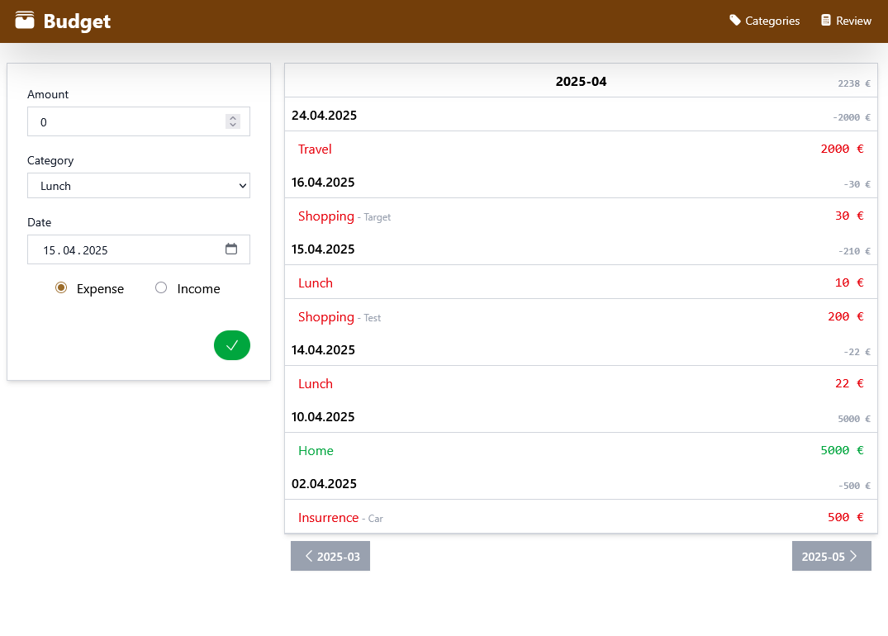
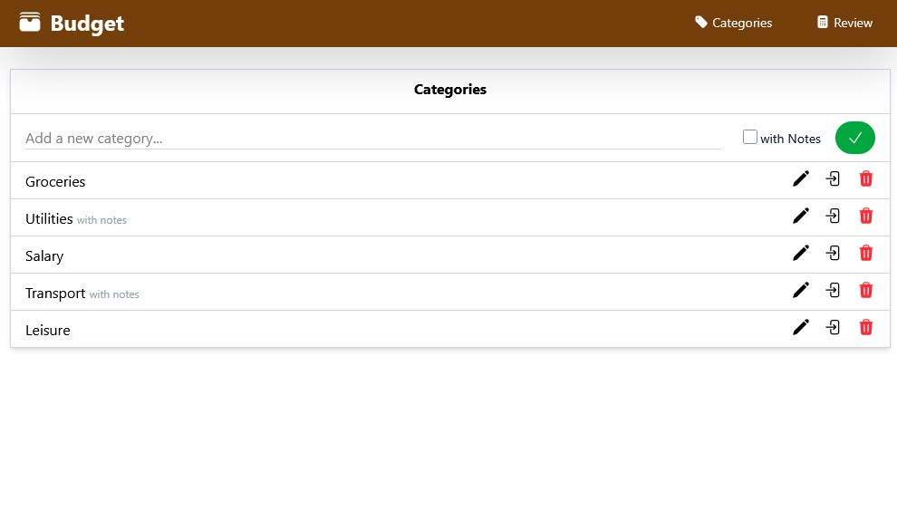
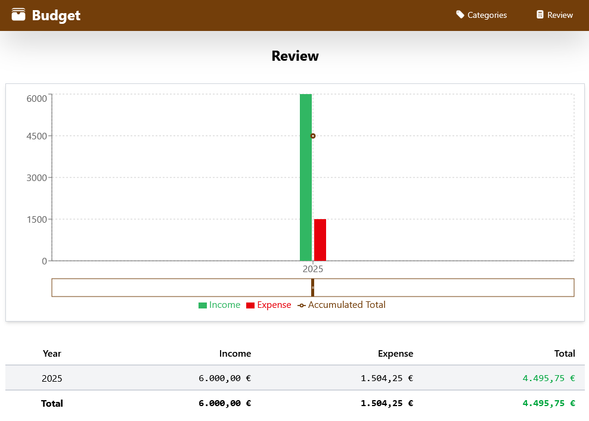
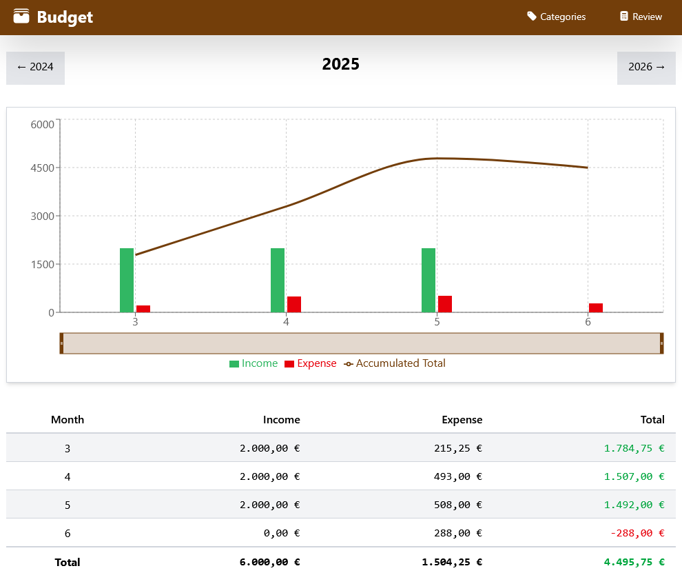

# Budget

A self-hosted budget app for a family. It tracks expenses and income by category, without accounting knowledge. Each ledger is its own SQLite file; people sign in with their existing OpenID Connect login and open the ledgers they are allowed to.

| Month | Categories |
| --- | --- |
|  |  |

| Review yearly | Review monthly |
| --- | --- |
|  |  |

## Features

- Enter transactions fast: arithmetic in the amount field (`12+4,50`), templates for recurring payments, a note only for categories that need one.
- Search the month or all months: words in the note, `#category`, `=amount`.
- Review income and expense by year and month, filtered by category, with an accumulated total.
- Several ledgers per instance; an access file says which account may open which ledger.
- Sign-in by OpenID Connect (e.g. Nextcloud); the app stores no passwords.
- Installable as an app (PWA). New entries made offline wait on the phone and are sent later; an entry sent twice is saved once.
- German or English, one currency per instance.

## Stack

Go with one dependency (`github.com/mattn/go-sqlite3`), and a plain-JavaScript interface on vendored [auril.js](https://github.com/nogo/auril) with no build step. The server embeds and serves the interface. See `docs/` for the goal, decisions and the server–browser contract.

## Development

Needs [mise](https://mise.jdx.dev) and a C compiler (cgo).

```sh
mise install
mise run check          # vet, gofmt, tidy, tests
mise run test:browser   # interface checks in Chrome (needs agent-browser)
mise run dev            # serve ./data with a development login, no OIDC
```

`mise run dev` expects `data/access.json` and a ledger file; create an empty one with `go run ./cmd/budget new data/household.sqlite`.

## Ledgers and access

```sh
budget new household.sqlite                 # empty ledger
budget import old-budget.sqlite household.sqlite  # from a database of the old 2.x app
```

`access.json` in the data directory:

```json
{
  "ledgers": [{ "id": "household", "name": "Haushalt", "file": "household.sqlite" }],
  "accounts": { "<OIDC sub>": ["household"] }
}
```

The server rereads it when it changes.

## Docker

```sh
cp .env.example .env   # fill in base URL, session secret, OIDC client
docker compose up -d --build
```

Ledger files and `access.json` live in the `/data` volume; the container runs as user 1000. Back up while the server runs with `docker compose exec budget budget backup /data/backup`; a plain file copy can miss recent writes in WAL mode.

## Release

Production runs a tagged release, never a branch tip.

1. On a checked `main` (`mise run check`, `mise run test:browser`): `git tag -a v3.1.0 -m v3.1.0 && git push origin main v3.1.0`.
2. In rivendell's `config.yml`, set the budget stack's `tag:` and its `VERSION` build argument to the new tag, push, then `herald deploy budget`.

## License

MIT
